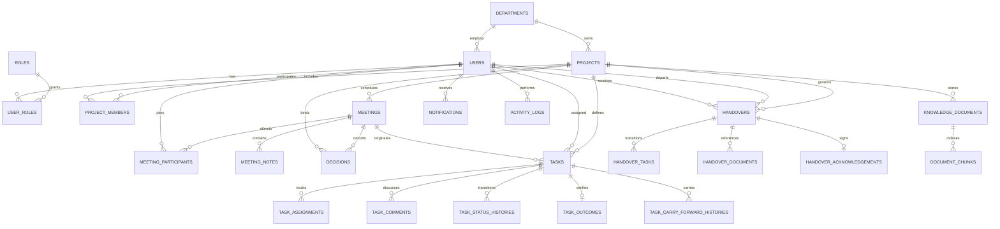

# HandoffIQ Relational Database Schema & ERD Documentation

The HandoffIQ database is fully normalized to 3NF, MySQL 8.0 compliant, and version-controlled via Flyway database migrations (`V1__initial_schema.sql` and `V2__seed_realistic_data.sql`).

---

## 1. Entity-Relationship Overview

---

## 2. Table Catalog (24 Relational Tables)

### A. Organization & Authentication
1. **`roles`**: System roles (`ROLE_ADMIN`, `ROLE_MANAGER`, `ROLE_EMPLOYEE`).
2. **`departments`**: Organizational departments (`Engineering`, `Product & Design`, `Human Resources`).
3. **`users`**: User identities, BCrypt password hashes, email, job title, department foreign key, active status.
4. **`user_roles`**: Join table mapping users to roles (supports multi-role or single-role RBAC).
5. **`projects`**: Active and completed project workspaces with department associations.
6. **`project_members`**: Join table binding users to projects with project-specific roles (`Lead`, `Developer`, `Contributor`).

### B. Meeting Management & Decisions
7. **`meetings`**: Scheduled, in-progress, completed, and cancelled meeting records with dates, times, and agendas.
8. **`meeting_participants`**: Meeting attendees with attendance status (`INVITED`, `ATTENDED`, `EXCUSED`).
9. **`meeting_notes`**: Raw and AI-summarized discussion notes tied to meetings.
10. **`decisions`**: Architectural and business decisions formalized during meetings with rationale and impacted areas.

### C. Task Management & Outcome Accountability
11. **`tasks`**: Work items with title, project, assignee, creator, priority (`LOW`, `MEDIUM`, `HIGH`, `CRITICAL`), status (`TO_DO`, `IN_PROGRESS`, `BLOCKED`, `COMPLETED`, `CANCELLED`), dates, and carry-forward count.
12. **`task_assignments`**: Historical assignment audit trail (who held the task and during what timeframe).
13. **`task_comments`**: Discussion thread for blockers, questions, and updates.
14. **`task_status_histories`**: Audit log recording every state transition (`previous_status` -> `new_status`), timestamp, and reason.
15. **`task_outcomes`**: Verifiable completion record requiring outcome descriptions (e.g. "Completed successfully", "Documentation merged", "Issue escalated").
16. **`task_carry_forward_histories`**: Audit trail of carried-forward tasks across sprint iterations and meetings without data loss.

### D. Smart Employee Handover (Special Innovation)
17. **`handovers`**: Transition packages capturing departing employee, receiving employee, project, reason, target date, readiness score (0-100), AI summary, and lifecycle status (`DRAFT`, `AWAITING_REVIEW`, `AWAITING_ACCEPTANCE`, `ACCEPTED`, `COMPLETED`).
18. **`handover_tasks`**: Specific tasks bundled into the handover package.
19. **`handover_documents`**: Specific runbooks, credentials, and architecture documents attached to the transfer.
20. **`handover_acknowledgements`**: Formal receipt acknowledgement digitally signed by the incoming employee.

### E. Knowledge Base & AI Semantic Retrieval
21. **`knowledge_documents`**: Repository of technical documentation, runbooks, and handover reports.
22. **`document_chunks`**: Segmented text chunks for vector/semantic search indexing and cited retrieval.
23. **`notifications`**: User alert entries (overdue items, approaching deadlines, unassigned work, handover receipts).
24. **`activity_logs`**: System-wide audit trail recording user operations with IP, correlation ID, and timestamp.
25. **`ai_interaction_logs`**: Audit trail of AI prompts, token usage, latency, and structured responses.

---

## 3. Indexing & Performance Strategy
- Foreign keys across all tables are indexed to eliminate table scans on joins (`idx_tasks_project`, `idx_tasks_assignee`, `idx_handovers_receiver`).
- Full-text or B-tree indexes on `title`, `task_code`, and `status` optimize dashboard filter queries.
- Flyway migrations guarantee repeatable deployments across local, test, staging, and production AWS RDS environments.
